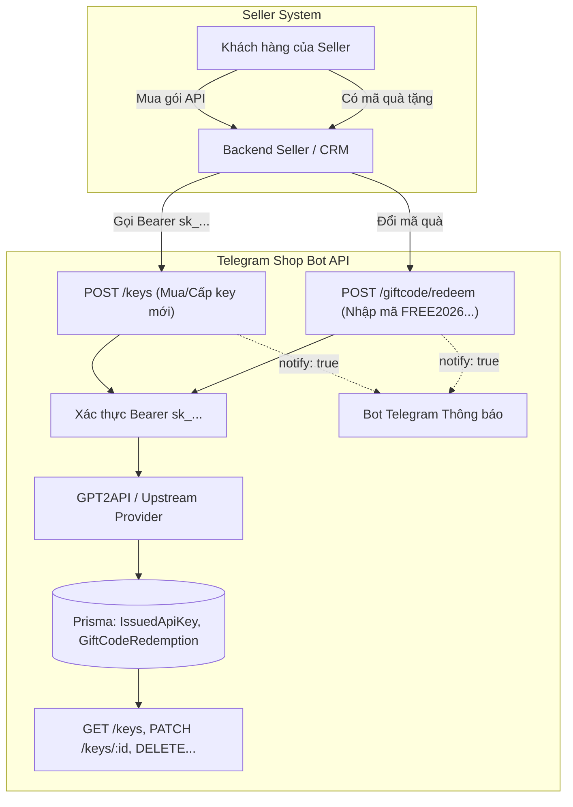

# Hướng dẫn Toàn diện Seller API: Cấp Key, Quản lý Key & Đổi Mã Quà Tặng (Giftcode)

Tài liệu chi tiết dành cho Nhà cung cấp / Đối tác / Seller tích hợp hệ thống Telegram Shop Bot qua REST API.

---

## 1. Tổng quan & Xác thực

- **Base URL**: `https://<domain_cua_ban>/api/seller`
- **Tài liệu trực quan trên web**: `GET https://<domain_cua_ban>/api/seller/docs` (yêu cầu header xác thực)
- **Header bắt buộc**:
  ```http
  Authorization: Bearer <SELLER_KEY_CUA_BAN>
  Content-Type: application/json
  ```
  *(Seller Key có định dạng `sk_...` do Admin tạo trong Web Admin Panel)*

> [!IMPORTANT]
> **Quy tắc bảo mật chuỗi Key `sk-*`:**
> Chuỗi API key thật (dùng để gọi AI) **CHỈ ĐƯỢC TRẢ VỀ DUY NHẤT 1 LẦN** trong response của:
> - `POST /api/seller/keys` (Cấp key mới)
> - `POST /api/seller/giftcode/redeem` (Đổi giftcode nhận key)
>
> Tất cả các API tra cứu danh sách, chi tiết, hoặc thống kê sau đó đều **che key** dạng `sk-abc…wxyz` để chống rò rỉ.

---

## 2. Luồng Nghiệp vụ Kết nối (Bán hàng + Tặng quà)



---

## 3. Danh sách Server / Profiles khả dụng

Trước khi tạo key, bạn có thể kiểm tra danh sách server đang mở bán, đơn giá `$ / 1M token`, hạn mức tối đa:

### `GET /api/seller/profiles`
- **Mô tả**: Lấy danh sách server API đang hoạt động.
- **cURL mẫu**:
  ```bash
  curl -X GET https://shop.example.com/api/seller/profiles \
    -H "Authorization: Bearer sk_seller_123456"
  ```
- **Response mẫu**:
  ```json
  {
    "profiles": [
      {
        "id": 1,
        "name": "Server Cao Cấp (Claude / GPT-4o)",
        "usdPerMtoken": 0.015,
        "quotaRefPrice": 0.015,
        "maxBuyTokens": 500000000,
        "rpm": 300,
        "validDays": 30,
        "models": ["gpt-4o", "claude-3-5-sonnet-20241022"]
      }
    ]
  }
  ```

---

## 4. Cấp API Key mới (Bán hàng cho khách)

### `POST /api/seller/keys`
- **Mô tả**: Trừ quota của shop để cấp 1 key thật (`sk-*`) cho khách của Seller.
- **Tham số Request Body**:
  | Tham số | Kiểu | Bắt buộc | Mô tả |
  |---|---|---|---|
  | `tokens` | `string \| int` | **Có** | Số lượng token (chấp nhận: `10000000`, `"10m"`, `"10tr"`, `"1b"`). |
  | `telegramId` | `string` | Không | ID Telegram của khách (nếu có, key tự vào `/mykey` của người đó). |
  | `profileId` | `int` | Không | ID Server (lấy từ `/profiles`). Bỏ trống = server đầu tiên đang bật. |
  | `validDays` | `int` | Không | Số ngày hạn dùng (1–3650, hoặc `0` = không hết hạn). |
  | `rpm` | `int` | Không | Giới hạn số request/phút (10–10000). Bỏ trống = mặc định server. |
  | `clientRef` | `string` | **Khuyên dùng** | Mã đơn/ID giao dịch của bạn để **chống cấp trùng** khi retry. |
  | `notify` | `bool` | Không | `true` = Bot gửi tin nhắn riêng cho `telegramId` thông báo key. |
  | `name` | `string` | Không | Tên/nhãn gợi nhớ cho key (≤ 60 ký tự). |

- **cURL mẫu**:
  ```bash
  curl -X POST https://shop.example.com/api/seller/keys \
    -H "Authorization: Bearer sk_seller_123456" \
    -H "Content-Type: application/json" \
    -d '{
      "tokens": "20m",
      "validDays": 30,
      "telegramId": "777888999",
      "clientRef": "ORDER_SELLER_001",
      "notify": true,
      "name": "Khach_VIP_001"
    }'
  ```

- **Response thành công (HTTP 200)**:
  ```json
  {
    "ok": true,
    "id": "ckkey_99887766",
    "key": "sk-REAL-KEY-ABCXYZ1234567890",
    "keyMasked": "sk-REA…7890",
    "quotaTokens": 20000000,
    "rpm": 300,
    "validDays": 30,
    "expiresAt": "2026-11-04T15:00:00.000Z",
    "profileId": 1,
    "profileName": "Server Cao Cấp",
    "models": ["gpt-4o", "claude-3-5-sonnet-20241022"],
    "endpoint": "https://api.provider.com",
    "usageUrl": "https://api.provider.com/usage",
    "priceUsd": 0.3,
    "notified": true
  }
  ```

---

## 5. Đổi Mã Quà Tặng (Nhập Giftcode như FREE2026)

Hệ thống hỗ trợ Seller tự nhập mã quà tặng (hoặc nhập hộ khách hàng).

### `POST /api/seller/giftcode/redeem`
- **Mô tả**: Đổi mã giftcode (ví dụ `FREE2026`, `TET2026`) để nhận API key hoặc số dư ví.
- **Tính năng nổi bật**:
  - Tự động gán nguồn `SELLER` và `sellerKeyId` để key xuất hiện ngay trong danh sách quản lý của Seller.
  - Cho phép gắn `telegramId` để khách xem được trong `/mykey` của bot Telegram.
  - Nếu không truyền `telegramId`, hệ thống tự tính lượt đổi theo tài khoản của chính Seller.
- **Tham số Request Body**:
  | Tham số | Kiểu | Bắt buộc | Mô tả |
  |---|---|---|---|
  | `code` | `string` | **Có** | Mã quà tặng (ví dụ `FREE2026`). Không phân biệt hoa/thường. |
  | `telegramId` | `string` | Không | ID Telegram của khách nhận quà. |
  | `notify` | `bool` | Không | `true` = Bot gửi tin nhắn chứa key đến khách (cần khách đã `/start` bot). |

- **cURL mẫu**:
  ```bash
  curl -X POST https://shop.example.com/api/seller/giftcode/redeem \
    -H "Authorization: Bearer sk_seller_123456" \
    -H "Content-Type: application/json" \
    -d '{
      "code": "FREE2026",
      "telegramId": "777888999",
      "notify": true
    }'
  ```

- **Response thành công (HTTP 200 - Nhận API Key)**:
  ```json
  {
    "ok": true,
    "rewardType": "APIKEY",
    "id": "ckkey_gift_12345",
    "code": "FREE2026",
    "key": "sk-FREE2026-KEY-REAL-ABCXYZ",
    "keyMasked": "sk-FRE…CXYZ",
    "quotaTokens": 20000000,
    "rpm": 300,
    "expiresAt": "2026-11-04T15:00:00.000Z",
    "profileId": 1,
    "profileName": "Server Miễn Phí",
    "models": ["gpt-4o-mini"],
    "endpoint": "https://api.provider.com",
    "docUrl": "https://docs.provider.com",
    "telegramId": "777888999",
    "note": "Chúc mừng bạn đã nhận key quà tặng năm mới!",
    "notified": true
  }
  ```

- **Response thành công (HTTP 200 - Nhận số dư ví WALLET)**:
  ```json
  {
    "ok": true,
    "rewardType": "WALLET",
    "code": "FREE2026",
    "amount": 50000,
    "newBalance": 150000,
    "telegramId": "777888999",
    "note": "Cộng tiền thành công"
  }
  ```

- **Các mã lỗi thường gặp (HTTP 4xx / 5xx)**:
  | Code | HTTP Status | Ý nghĩa |
  |---|---|---|
  | `missing_code` | 400 | Chưa truyền tham số `code`. |
  | `invalid_telegram_id` | 400 | `telegramId` sai định dạng (phải là dãy số từ 3 ký tự). |
  | `INVALID` | 400 | Mã không tồn tại hoặc sai quy cách. |
  | `INACTIVE` | 400 | Mã đang bị admin khoá. |
  | `EXPIRED` | 400 | Mã đã quá hạn sử dụng. |
  | `USED_UP` | 409 | Mã đã hết tổng số lượt sử dụng toàn hệ thống. |
  | `ALREADY_USED` | 409 | Bạn hoặc Telegram ID này đã dùng hết số lần cho phép của mã. |
  | `VIP_REQUIRED` | 403 | Mã chỉ dành cho cấp độ VIP cao hơn. |
  | `KEY_FAILED` | 502 | Provider tạo key gặp lỗi, mã được hoàn lại tự động không bị cháy. |

---

## 6. Quản lý Vòng đời Key (Gia hạn, Bật/Tắt, Thu hồi)

Tất cả các key tạo qua `POST /keys` hoặc đổi từ `POST /giftcode/redeem` đều có thể tra cứu và điều khiển:

### 6.1. Danh sách key của Seller
- **`GET /api/seller/keys?page=1&limit=50&live=1`**
  - `live=1` (mặc định): Kèm số liệu quota đã dùng, số ngày còn lại lấy trực tiếp từ server upstream.
  - `live=0`: Tắt đọc số liệu provider để phân trang cực nhanh.

### 6.2. Chi tiết 1 key
- **`GET /api/seller/keys/:id`**
  - Trả về chi tiết key và khối `live`:
    ```json
    {
      "key": {
        "id": "ckkey_99887766",
        "keyMasked": "sk-REA…7890",
        "quotaTokens": 20000000,
        "live": {
          "status": "active", // active | low | exhausted | expired | disabled
          "quotaLimit": 20000000,
          "quotaUsed": 2450000,
          "quotaRemaining": 17550000,
          "daysRemaining": 26,
          "enabled": true,
          "renewability": {
            "canAddTokens": true,
            "canAddDays": true
          }
        }
      }
    }
    ```

### 6.3. Gia hạn thêm Token / Ngày dùng
- **`PATCH /api/seller/keys/:id`**
  - **Body**:
    ```json
    {
      "addTokens": 10000000,
      "addDays": 30,
      "clientRef": "RENEW_ORDER_8891"
    }
    ```
  - Có cơ chế khoá nguyên tử chống cộng trùng token khi kết nối mạng chập chờn.

### 6.4. Bật hoặc Tạm tắt Key
- **`PATCH /api/seller/keys/:id/enabled`**
  - **Body**: `{"enabled": false}` (tắt key, khách gọi API sẽ bị từ chối)
  - **Body**: `{"enabled": true}` (mở lại key)

### 6.5. Thu hồi / Ẩn Key
- **`DELETE /api/seller/keys/:id?revoke=true`**
  - `revoke=true` (mặc định): Tắt vĩnh viễn key trên provider và ẩn khỏi `/mykey`.
  - `revoke=false`: Chỉ ẩn khỏi Telegram bot, key trên provider vẫn hoạt động.

---

## 7. Thống kê & Báo cáo Doanh số

- **`GET /api/seller/stats`**: Thống kê tổng số key và tổng quan.
- **`GET /api/seller/stats/keys?days=30`**: Thống kê số lượng key theo trạng thái (`active`, `low`, `exhausted`, `expired`, `disabled`) và biến động theo từng ngày.
- **`GET /api/seller/stats/users/daily?days=30&top=20`**: Xếp hạng khách hàng chi tiêu nhiều nhất (ID khách hàng được mã hoá bảo mật `u_xxxx` theo từng seller).

---

## 8. Nguyên tắc Idempotency (Chống Cấp Trùng)

Tạo key (`POST /keys`) và gia hạn (`PATCH /keys/:id`) là các thao tác tốn tài nguyên thật:
1. Luôn gửi kèm trường `clientRef` (ví dụ mã đơn hàng trên website của Seller).
2. Nếu request bị mạng timeout, hãy **gửi lại đúng `clientRef` cũ**:
   - Hệ thống sẽ trả lại thông tin đơn cũ kèm `"duplicate": true`, không trừ thêm tiền hay cấp thêm token.
3. Nếu nhận HTTP `409` hoặc `"retryable": false`: **Dừng lại** và kiểm tra `reconcileId` với admin của shop, không tự ý retry với ref mới.
